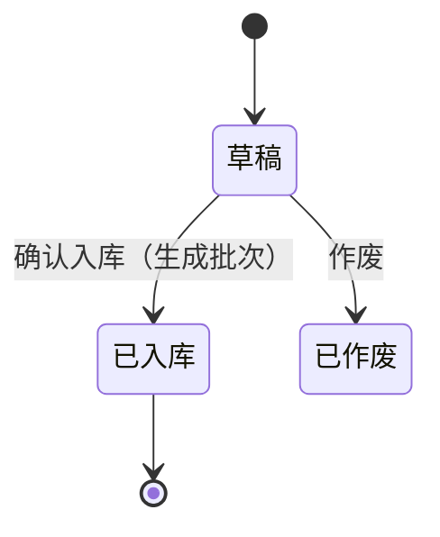
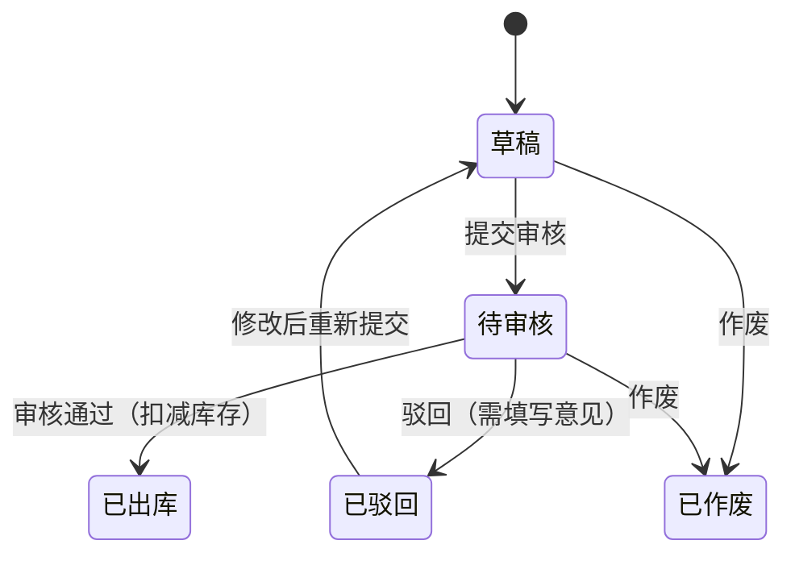

# 功能说明（URL / 视图 / 权限对照）

## 一、访问控制设计

1. 每个菜单对应一个**权限编码**（`accounts_menu.code`），例如 `herb.list`。
2. 视图用装饰器校验：

```python
@menu_required("herb.list")
def herb_list(request): ...
```

3. 校验逻辑（`core/permissions.py`）：
   - 未登录 → 跳转登录页；
   - 超级管理员 → 直接放行；
   - 其他用户 → 检查其角色是否勾选了该菜单；
   - 无权限 → 渲染 `403.html`（HTTP 403）。
4. 模板中可用 `menu_codes` 判断按钮是否显示，例如审批按钮：
   ``。

### 权限矩阵

| 权限编码 | 菜单 | 超级管理员 | 仓管员 | 审核员 | 普通员工 |
| --- | --- | :-: | :-: | :-: | :-: |
| dashboard | 工作台 | ✓ | ✓ | ✓ | ✓ |
| herb.list | 药材档案 | ✓ | ✓ | | |
| inbound.list | 入库管理 | ✓ | ✓ | | |
| outbound.list | 领用出库 | ✓ | ✓ | ✓ | ✓ |
| outbound.approve | 出库审核 | ✓ | | ✓ | |
| inventory.stock | 库存查询 | ✓ | ✓ | ✓ | |
| inventory.stats | 统计分析 | ✓ | ✓ | ✓ | |
| inventory.log | 操作日志 | ✓ | | | |
| system.user | 用户管理 | ✓ | | | |
| system.role | 角色权限 | ✓ | | | |
| system.menu | 菜单管理 | ✓ | | | |

---

## 二、路由与视图

### 1. 工作台（core）

| URL | 视图 | 权限 | 功能 |
| --- | --- | --- | --- |
| `/` | `core.views.dashboard` | 登录即可 | 库存/批次/预警/待办指标、分类占比图、Top8、最近入库出库、操作动态 |

### 2. 用户与权限（accounts）—— 学生 1

| URL 名称 | 实际路径 | 视图 | 权限 | 功能 |
| --- | --- | --- | --- | --- |
| `accounts:login` | `/accounts/login/` | `login_view` | 公开 | 账号密码登录，失败提示 |
| `accounts:logout` | `/accounts/logout/` | `logout_view` | 登录 | 退出并清空会话 |
| `accounts:register` | `/accounts/register/` | `register_view` | 公开 | 注册，默认「普通员工」角色 |
| `accounts:profile` | `/accounts/profile/` | `profile` | 登录 | 个人信息、修改密码 |
| `accounts:user_list` | `/accounts/users/` | `user_list` | system.user | 用户检索、角色筛选、分页 |
| `accounts:user_create` | `/accounts/users/create/` | `user_form` | system.user | 新增用户、分配角色 |
| `accounts:user_edit` | `/accounts/users/<id>/edit/` | `user_form` | system.user | 编辑用户（留空不改密码） |
| `accounts:user_toggle` | `/accounts/users/<id>/toggle/` | `user_toggle` | system.user | 启用/停用账号（POST） |
| `accounts:user_reset_password` | `/accounts/users/<id>/reset-password/` | `user_reset_password` | system.user | 重置为 Tcm@123456（POST） |
| `accounts:role_list` | `/accounts/roles/` | `role_list` | system.role | 角色卡片、菜单数量、用户数 |
| `accounts:role_create` | `/accounts/roles/create/` | `role_form` | system.role | 新增角色并勾选菜单 |
| `accounts:role_edit` | `/accounts/roles/<id>/edit/` | `role_form` | system.role | 调整角色菜单权限 |
| `accounts:role_delete` | `/accounts/roles/<id>/delete/` | `role_delete` | system.role | 删除空角色（POST） |
| `accounts:menu_list` | `/accounts/menus/` | `menu_list` | system.menu | 菜单/接口权限清单 |
| `accounts:menu_create` | `/accounts/menus/create/` | `menu_form` | system.menu | 新增菜单权限 |
| `accounts:menu_edit` | `/accounts/menus/<id>/edit/` | `menu_form` | system.menu | 编辑菜单权限 |

### 3. 中药材档案（herbs）—— 学生 2

| URL 名称 | 实际路径 | 视图 | 功能 |
| --- | --- | --- | --- |
| `herbs:list` | `/herbs/` | `herb_list` | 关键词（名称/编码/拼音/产地）、分类、库存状态筛选，4 种排序，分页 |
| `herbs:create` | `/herbs/create/` | `herb_form` | 新增档案，编码唯一校验 |
| `herbs:detail` | `/herbs/<id>/` | `herb_detail` | 档案 + 批次 + 流水 + 入出库记录三标签页 |
| `herbs:edit` | `/herbs/<id>/edit/` | `herb_form` | 编辑档案 |
| `herbs:delete` | `/herbs/<id>/delete/` | `herb_delete` | 删除（有业务数据则拒绝，建议停用） |
| `herbs:export` | `/herbs/export/?fmt=xlsx\|csv` | `herb_export` | 按当前筛选条件导出 |
| `herbs:category_list` | `/herbs/categories/` | `category_list` | 分类列表 + 快速新增 |
| `herbs:category_create` | `/herbs/categories/create/` | `category_form` | 新增分类 |
| `herbs:category_edit` | `/herbs/categories/<id>/edit/` | `category_form` | 编辑分类 |
| `herbs:category_delete` | `/herbs/categories/<id>/delete/` | `category_delete` | 删除空分类 |

### 4. 入库与批次（inbound）—— 学生 3

| URL 名称 | 实际路径 | 视图 | 功能 |
| --- | --- | --- | --- |
| `inbound:list` | `/inbound/` | `inbound_list` | 单号/供应商、状态、日期区间筛选，分页 |
| `inbound:create` | `/inbound/create/` | `inbound_form` | 主子表录入，最多 20 条明细，动态增删行 |
| `inbound:detail` | `/inbound/<id>/` | `inbound_detail` | 单据 + 明细 + 金额合计 |
| `inbound:edit` | `/inbound/<id>/edit/` | `inbound_form` | 仅草稿可编辑 |
| `inbound:confirm` | `/inbound/<id>/confirm/` | `inbound_confirm` | 确认入库 → 生成批次 + 入库流水 |
| `inbound:cancel` | `/inbound/<id>/cancel/` | `inbound_cancel` | 作废草稿 |
| `inbound:export` | `/inbound/export/` | `inbound_export` | 导出入库单 |
| `inbound:print` | `/inbound/<id>/print/` | `inbound_print` | 打印页（A4 版式，含明细金额合计与签字栏，可另存 PDF） |

### 5. 领用与出库（outbound）—— 学生 4

| URL 名称 | 实际路径 | 视图 | 权限 | 功能 |
| --- | --- | --- | --- | --- |
| `outbound:list` | `/outbound/` | `outbound_list` | outbound.list | 单号/部门/用途、状态、日期筛选 |
| `outbound:create` | `/outbound/create/` | `outbound_form` | outbound.list | 领用申请，可选批次 |
| `outbound:detail` | `/outbound/<id>/` | `outbound_detail` | outbound.list | 单据、流转时间线、审核入口 |
| `outbound:edit` | `/outbound/<id>/edit/` | `outbound_form` | outbound.list | 草稿/被驳回可编辑 |
| `outbound:submit` | `/outbound/<id>/submit/` | `outbound_submit` | outbound.list | 提交审核（草稿 → 待审核） |
| `outbound:approve` | `/outbound/<id>/approve/` | `outbound_approve` | outbound.approve | 审核通过 → 扣减库存 + 出库流水 |
| `outbound:reject` | `/outbound/<id>/reject/` | `outbound_reject` | outbound.approve | 驳回，必须填写意见 |
| `outbound:cancel` | `/outbound/<id>/cancel/` | `outbound_cancel` | outbound.list | 作废未出库单据 |
| `outbound:export` | `/outbound/export/` | `outbound_export` | outbound.list | 导出出库单 |
| `outbound:print` | `/outbound/<id>/print/` | `outbound_print` | outbound.list | 打印页（A4 版式，含领用明细、附件清单与三方签字栏） |
| `outbound:attachment_upload` | `/outbound/<id>/attachments/upload/` | `attachment_upload` | outbound.list | 上传领用凭证/现场照片，限制 5MB 与文件类型 |
| `outbound:attachment_delete` | `/outbound/<id>/attachments/<att_id>/delete/` | `attachment_delete` | outbound.list | 删除附件（同时清除磁盘文件） |

### 6. 库存与统计（inventory）—— 学生 5

| URL 名称 | 实际路径 | 视图 | 功能 |
| --- | --- | --- | --- |
| `inventory:stock` | `/inventory/stock/` | `stock_list` | 关键词、分类、低库存/缺货、临期多条件查询，库存金额合计 |
| `inventory:stock_export` | `/inventory/stock/export/` | `stock_export` | 导出库存台账 |
| `inventory:batch_list` | `/inventory/batches/` | `batch_list` | 批次查询（药材、效期、批次号） |
| `inventory:stats` | `/inventory/stats/` | `stats` | Pandas 汇总 + 4 组图表 + 预警清单 |
| `inventory:ledger` | `/inventory/ledger/` | `ledger_list` | 流水按药材/类型/日期检索 |
| `inventory:ledger_export` | `/inventory/ledger/export/` | `ledger_export` | 导出流水 |
| `inventory:logs` | `/inventory/logs/` | `log_list` | 操作日志检索（模块/关键词/日期） |

---

## 三、状态机

### 入库单



### 出库单



---

## 四、统计口径

| 指标 | 计算方式 |
| --- | --- |
| 当前库存 | `Σ batch.remaining_quantity`（`status='active'`） |
| 库存金额 | 当前库存 × 药材参考单价 |
| 库存状态 | 0 → 缺货；< 下限 → 低库存；否则正常 |
| 近效期 | `expiry_date ≤ 今天 + 90 天` 且仍有剩余 |
| 出入库趋势 | 近 6 个月 `stock_ledger` 按月汇总，出库取绝对值 |
| 分类占比 | Pandas `groupby(category).sum(stock)` 后按库存降序 |
| Top10 | Pandas `sort_values(stock, ascending=False).head(10)` |

---

## 五、可扩展点（答辩加分）

- 接口化：把视图函数改为 DRF `APIView`，菜单的 `api_scope` 已预留接口权限标识；
- 盘点：`StockLedger.biz_type` 已支持 `adjust`，可增加盘点单；
- 消息通知：近效期/低库存可接入邮件或企业微信机器人；
- 审批流：可扩展为多级审核（`status` 增加 `level` 字段或引入审批流水表）。
