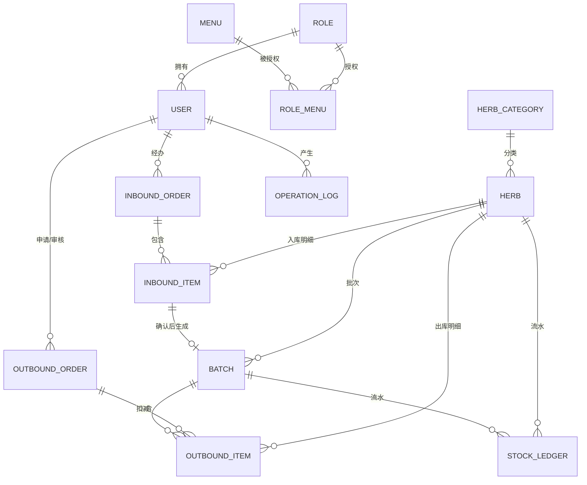

# 数据库设计说明

> 数据库名：`tcm_inventory`　字符集：`utf8mb4`　排序规则：`utf8mb4_general_ci`
> 开发环境默认 SQLite，生产/答辩演示可切换 MySQL 8。

## 一、实体关系（ER）

核心思路：

1. **药材档案**是基础数据，**批次**是库存最小单元；
2. 入库单确认时才生成批次（草稿不占用库存），保证「单据 → 批次 → 库存」一致；
3. 出库审核通过时按**近效期优先**扣减批次，并写入库存流水；
4. 所有变动都有 `stock_ledger` 记录，形成可追溯链路。

---

## 二、表结构

### 1. accounts_role（角色）

| 字段 | 类型 | 约束 | 说明 |
| --- | --- | --- | --- |
| id | bigint | PK, AUTO | 主键 |
| name | varchar(50) | UNIQUE, NOT NULL | 角色名称 |
| code | varchar(50) | UNIQUE, NOT NULL | 角色编码，如 keeper |
| description | varchar(200) | | 角色说明 |
| is_active | tinyint(1) | NOT NULL DEFAULT 1 | 是否启用 |
| created_at | datetime | NOT NULL | 创建时间 |

### 2. accounts_menu（菜单 / 权限点）

| 字段 | 类型 | 约束 | 说明 |
| --- | --- | --- | --- |
| id | bigint | PK | |
| code | varchar(50) | UNIQUE, NOT NULL | 权限编码，与视图装饰器一致 |
| name | varchar(50) | NOT NULL | 菜单名称 |
| group_name | varchar(20) | NOT NULL | 分组：工作台/业务管理/库存管理/系统管理 |
| url_name | varchar(80) | | Django 路由名，如 herbs:list |
| icon | varchar(40) | | Bootstrap Icons 类名 |
| api_scope | varchar(120) | | 接口权限标识，如 GET:/herbs/ |
| sort | int | NOT NULL DEFAULT 10 | 排序 |
| is_active | tinyint(1) | NOT NULL DEFAULT 1 | 是否启用 |
| created_at | datetime | NOT NULL | |

### 3. accounts_role_menu（角色-菜单授权）

| 字段 | 类型 | 约束 | 说明 |
| --- | --- | --- | --- |
| id | bigint | PK | |
| role_id | bigint | FK → accounts_role, NOT NULL | 角色 |
| menu_id | bigint | FK → accounts_menu, NOT NULL | 菜单 |
| created_at | datetime | NOT NULL | 授权时间 |

唯一约束：`(role_id, menu_id)`。

### 4. accounts_user（用户，继承 Django 内置用户）

| 字段 | 类型 | 约束 | 说明 |
| --- | --- | --- | --- |
| id | bigint | PK | |
| username | varchar(150) | UNIQUE | 登录账号 |
| password | varchar(128) | NOT NULL | 哈希后的密码 |
| real_name | varchar(50) | | 姓名 |
| phone | varchar(20) | | 手机号 |
| department | varchar(50) | | 部门 |
| role_id | bigint | FK → accounts_role, NULL | 角色 |
| is_active / is_staff / is_superuser | tinyint(1) | | Django 内置权限字段 |
| last_login / date_joined | datetime | | |

### 5. herbs_herbcategory（药材分类）

| 字段 | 类型 | 说明 |
| --- | --- | --- |
| id | bigint PK | |
| name | varchar(50) UNIQUE | 分类名称 |
| code | varchar(30) UNIQUE | 分类编码 |
| sort | int | 排序 |
| remark | varchar(200) | 备注 |

### 6. herbs_herb（中药材档案）

| 字段 | 类型 | 约束 | 说明 |
| --- | --- | --- | --- |
| id | bigint | PK | |
| code | varchar(30) | UNIQUE | 药材编码 |
| name | varchar(60) | NOT NULL | 药材名称 |
| pinyin | varchar(60) | | 拼音助记码 |
| category_id | bigint | FK → herbs_herbcategory, PROTECT | 分类 |
| spec | varchar(60) | | 规格 |
| unit | varchar(10) | | 计量单位 |
| origin | varchar(60) | | 产地 |
| shelf_life_days | int | DEFAULT 730 | 保质期（天） |
| storage_condition | varchar(100) | | 贮藏条件 |
| min_stock | decimal(12,2) | DEFAULT 10 | 库存下限（预警线） |
| price | decimal(12,2) | DEFAULT 0 | 参考单价 |
| status | varchar(10) | | active 启用 / inactive 停用 |
| remark | varchar(200) | | |
| created_at / updated_at | datetime | | |

### 7. inbound_inboundorder（入库单）

| 字段 | 类型 | 约束 | 说明 |
| --- | --- | --- | --- |
| id | bigint | PK | |
| order_no | varchar(40) | UNIQUE | 入库单号 RK+时间戳 |
| supplier | varchar(80) | NOT NULL | 供应商 |
| inbound_date | date | NOT NULL | 入库日期 |
| operator_id | bigint | FK → accounts_user, PROTECT | 经办人 |
| status | varchar(10) | | draft / confirmed / cancelled |
| remark | varchar(200) | | |
| created_at | datetime | | |
| confirmed_at | datetime | NULL | 确认时间 |

### 8. inbound_inbounditem（入库明细）

| 字段 | 类型 | 约束 | 说明 |
| --- | --- | --- | --- |
| id | bigint | PK | |
| order_id | bigint | FK → inbound_inboundorder, CASCADE | 入库单 |
| herb_id | bigint | FK → herbs_herb, PROTECT | 药材 |
| batch_no | varchar(50) | | 批次号（空则自动生成） |
| production_date | date | NULL | 生产日期 |
| expiry_date | date | NULL | 有效期至 |
| quantity | decimal(12,2) | NOT NULL | 入库数量 |
| unit_price | decimal(12,2) | | 单价 |
| batch_id | bigint | FK → inbound_batch, SET_NULL | 确认后关联批次 |

### 9. inbound_batch（库存批次）

| 字段 | 类型 | 约束 | 说明 |
| --- | --- | --- | --- |
| id | bigint | PK | |
| batch_no | varchar(50) | UNIQUE | 批次号 |
| herb_id | bigint | FK → herbs_herb, PROTECT | 药材 |
| production_date / expiry_date | date | NULL | 生产/有效期 |
| quantity | decimal(12,2) | | 入库数量 |
| remaining_quantity | decimal(12,2) | | 剩余数量 |
| unit_price | decimal(12,2) | | 入库单价 |
| supplier | varchar(80) | | 供应商 |
| status | varchar(10) | | active / exhausted / expired |
| created_at | datetime | | 入库时间 |

索引：`(herb_id, status)`。

### 10. outbound_outboundorder（出库单）

| 字段 | 类型 | 约束 | 说明 |
| --- | --- | --- | --- |
| id | bigint | PK | |
| order_no | varchar(40) | UNIQUE | 出库单号 CK+时间戳 |
| department | varchar(60) | NOT NULL | 领用部门 |
| purpose | varchar(120) | | 领用用途 |
| applicant_id | bigint | FK → accounts_user, PROTECT | 申请人 |
| apply_date | date | NOT NULL | 申请日期 |
| status | varchar(10) | | draft / pending / approved / rejected / cancelled |
| approver_id | bigint | FK → accounts_user, SET_NULL | 审核人 |
| approve_time | datetime | NULL | 审核时间 |
| approve_remark | varchar(200) | | 审核意见 |
| exception_note | text | | 异常备注（破损、短缺等） |
| remark | varchar(200) | | |
| created_at | datetime | | |

### 11. outbound_outbounditem（出库明细）

| 字段 | 类型 | 约束 | 说明 |
| --- | --- | --- | --- |
| id | bigint | PK | |
| order_id | bigint | FK → outbound_outboundorder, CASCADE | 出库单 |
| herb_id | bigint | FK → herbs_herb, PROTECT | 药材 |
| batch_id | bigint | FK → inbound_batch, SET_NULL | 指定批次（可空） |
| quantity | decimal(12,2) | NOT NULL | 领用数量 |
| remark | varchar(120) | | 明细备注 |

### 12. inventory_stockledger（库存流水）

| 字段 | 类型 | 约束 | 说明 |
| --- | --- | --- | --- |
| id | bigint | PK | |
| herb_id | bigint | FK → herbs_herb, PROTECT | 药材 |
| batch_id | bigint | FK → inbound_batch, SET_NULL | 批次 |
| biz_type | varchar(10) | | in / out / adjust |
| change_qty | decimal(12,2) | | 变动数量（入库正、出库负） |
| before_qty / after_qty | decimal(12,2) | | 变动前后库存 |
| ref_no | varchar(40) | | 关联单号 |
| operator_id | bigint | FK → accounts_user, SET_NULL | 操作人 |
| remark | varchar(200) | | |
| created_at | datetime | | |

### 13. core_operationlog（操作日志）

| 字段 | 类型 | 说明 |
| --- | --- | --- |
| id | bigint PK | |
| user_id | bigint FK → accounts_user, NULL | 操作人 |
| username | varchar(150) | 账号快照 |
| module | varchar(20) | auth/user/role/herb/inbound/outbound/inventory |
| action | varchar(100) | 操作名称 |
| target | varchar(150) | 操作对象 |
| detail | text | 详细说明 |
| ip | char(39) | 来源 IP |
| created_at | datetime | 操作时间 |

---

## 三、关键业务规则

1. **入库单**仅 `draft` 可编辑；确认后状态 `confirmed`，逐条生成 `batch`，并写 `stock_ledger(biz_type=in)`。
2. **批次号**默认 `PC + 日期 + 药材编码`，自动去重加序号；同一单内不允许重复。
3. **出库单**状态机：`draft → pending → approved / rejected`；`draft/pending/rejected` 可作废为 `cancelled`。
4. 审核通过时锁定批次行（`select_for_update`），按 `expiry_date ASC NULLS LAST` 扣减；库存不足直接回滚整个事务。
5. **库存**不单独存表，实时等于 `Σ batch.remaining_quantity where status='active'`，避免双写不一致。
6. 所有导出、登录、审核、确认等关键操作写 `core_operationlog`。

---

## 四、索引与性能

- `herbs_herb(name)`、`herbs_herb(pinyin)`：名称/拼音模糊检索
- `inbound_batch(herb_id, status)`：按药材汇总库存
- `inventory_stockledger(herb_id, created_at)`：流水查询与趋势统计
- 列表页统一分页（10~15 条/页），导出走流式生成，避免大数据量卡顿
